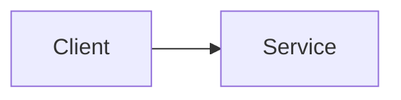

# {{title}}

> **Summary:** what we're building and the approach, in three sentences.

## Background
Link PRD/stories. Current state of the system.

## Goals / non-goals

## Design
### Architecture
<!-- Diagram (Mermaid ok), components, data flow -->

### Data model / API

### Security, privacy, performance

## Alternatives considered
| Option | Why not |
|---|---|
|  |  |

## Testing strategy

## Rollout & rollback

## Open questions
- [ ] 
